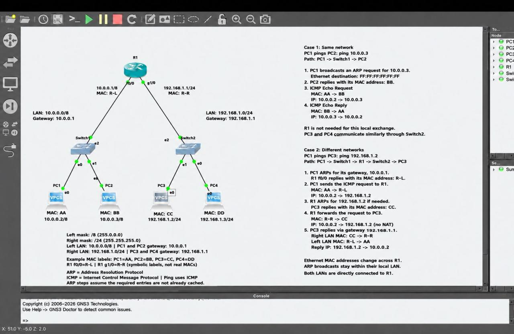
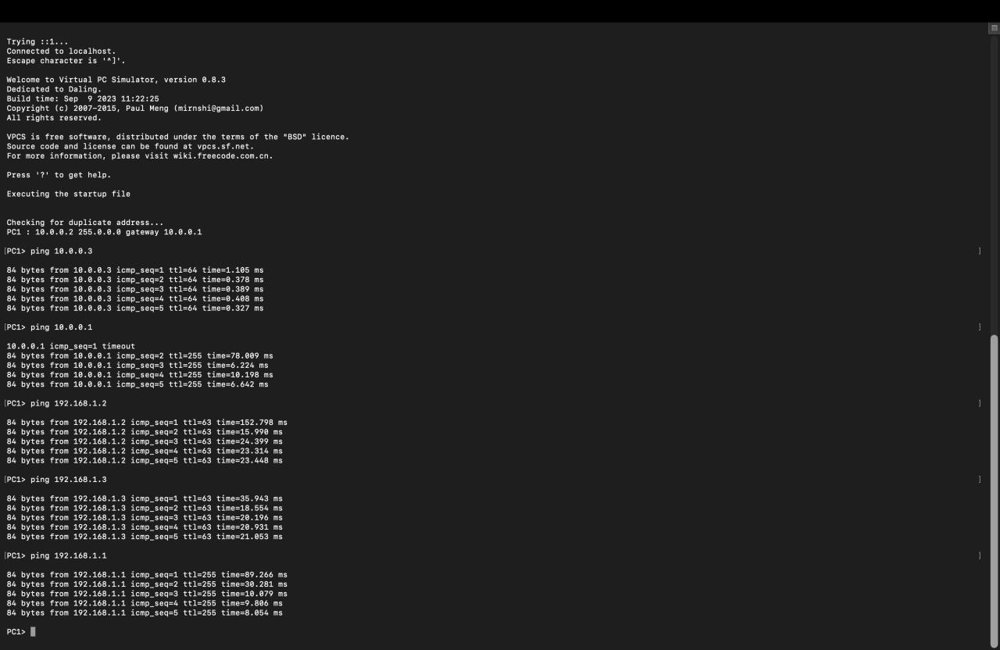

# Daily Networking Lab 1: Routing Between Two LANs in GNS3

First lab in my daily networking lab series, built independently in GNS3 with 1 router, 2 switches and 4 VPCS hosts.

## Topology

- Left LAN: 10.0.0.0/8, gateway 10.0.0.1 on R1 f0/0. PC1: 10.0.0.2; PC2: 10.0.0.3.
- Right LAN: 192.168.1.0/24, gateway 192.168.1.1 on R1 g1/0. PC3: 192.168.1.2; PC4: 192.168.1.3.
- Both LANs are directly connected to R1.

## What I tested

Same-LAN and cross-LAN connectivity from PC1 using ping. ARP resolves MAC addresses within each LAN. Across the router, Ethernet MAC addresses change while IP addresses stay the same (no NAT). ARP broadcasts stay within their local LAN.

## Observed ping results from PC1

- PC2: 5/5 replies, TTL 64.
- Local gateway: first request timed out; next 4 replied, TTL 255.
- PC3 and PC4: 5/5 replies each, TTL 63.
- R1 far-side interface: 5/5 replies, TTL 255.

## Skills practiced

IPv4 addressing, subnet masks, default gateways, ARP, ICMP, routing between LANs, Ethernet MAC addressing, TTL interpretation and connectivity testing.

Tools: GNS3 and VPCS.
